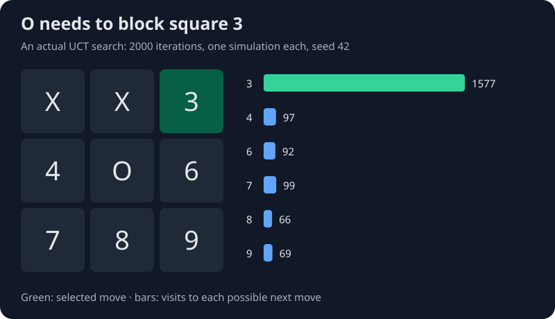
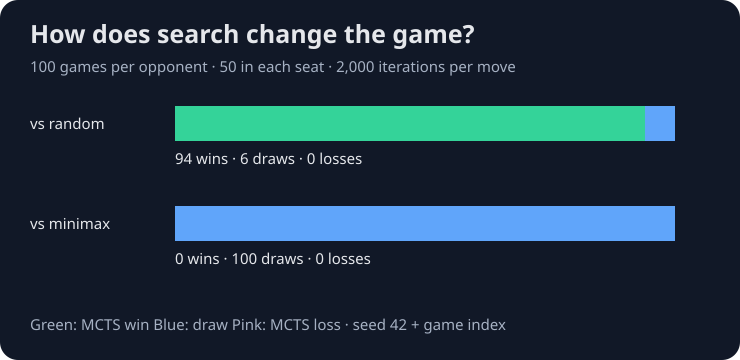

# SMCTS

SMCTS is a Scala project exploring Monte Carlo tree search in turn-based games. It builds a search tree, plays out possible continuations, and uses their results to decide which moves deserve more attention.



## Motivation

We wanted to explore how an agent can make decisions by sampling games rather than searching every possible continuation. Monte Carlo tree search gives us a way to try this across different games using the same search implementation.

Tic-tac-toe makes the decisions easy to inspect. We can see whether the agent takes a win, blocks a threat, or spends its search on an unhelpful move. We can also compare it with random play and an exact minimax opponent, where the expected behavior is well understood.

## How the search works

Each iteration has four parts:

1. **Selection:** follow the tree using UCB1, balancing promising moves with moves that have received less attention.
2. **Expansion:** add possible next moves when a new part of the tree is reached.
3. **Simulation:** play a random continuation to a result.
4. **Backpropagation:** update visit counts and rewards along the path back to the root.

Wins count as 1, draws as 0.5, and losses as 0. The reward is stored from each position's player-to-move perspective; selection converts it to the parent player's perspective. After the search budget is used, the agent chooses the most visited move.

The serial and parallel implementations share this process. The parallel version runs independent simulations together and then updates the tree serially, so simulations do not race to change shared counters.

## Results



These results use 100 games per opponent, with MCTS playing first in 50 and second in 50. Each decision gets 2,000 search iterations with one simulation per iteration. Game seeds are `42 + game index`; the random opponent has a separate seeded generator. The minimax opponent searches to the end of the game.

| Opponent | MCTS wins | Draws | MCTS losses |
|---|---:|---:|---:|
| Random | 94 | 6 | 0 |
| Exact minimax | 0 | 100 | 0 |

The opening figure shows how the search distributes its visits across the available moves. UCT combines the results of sampled continuations with an exploration bonus.

The [raw game results](docs/results.csv) and [tactical-position visit counts](docs/search.csv) are included. Both figures are generated by [PortfolioDemo.scala](src/main/scala/PortfolioDemo.scala).

## Running the project

Use Java 21 and [sbt](https://www.scala-sbt.org/download/) 1.9.9. The project uses Scala 3.4.1; sbt downloads the Scala dependencies.

```sh
git clone https://github.com/TheDeafOne/SMCTS.git
cd SMCTS
sbt test
sbt "runMain PortfolioDemo"
```

`PortfolioDemo` runs the benchmark and writes the two SVG figures and their CSV data to `docs/`. Run it from the repository root. The demo uses fixed seeds to reproduce the game outcomes and visit counts.

To watch a short console game between MCTS agents:

```sh
sbt "runMain tester"
```

## Game implementations

The search works with a `State` interface that supplies legal moves, a copy of the position, and a terminal result. The repository includes:

- **Tic-tac-toe:** bitboard representation, MCTS adapter, and greedy/minimax baselines. This is the game used for the figures and benchmark above.
- **Checkers:** position-local king tracking, compulsory captures, and multi-jump choices.
- **AB game:** a small jumping game used to experiment with the shared state interface.

Simulations stop after 512 plies and count unfinished games as draws, keeping rollouts bounded in cyclic games such as checkers and AB.

## Tests

The test suite covers forced wins and blocks, playing as either side, legal moves under a one-iteration budget, terminal draws, deterministic seeds, input-state preservation, and exact simulation accounting in both search implementations. It also checks checkers promotion isolation, compulsory multi-jumps, blocked-player losses, and occupied landings in AB.

The project is organized around [search](src/main/scala/algorithms/MonteCarloTreeSearch.scala), [game states](src/main/scala/games), and [focused regression tests](src/test/scala/SearchSpec.scala). Keeping the games behind one interface makes it easier to explore search behavior without rewriting the algorithm for each board.
